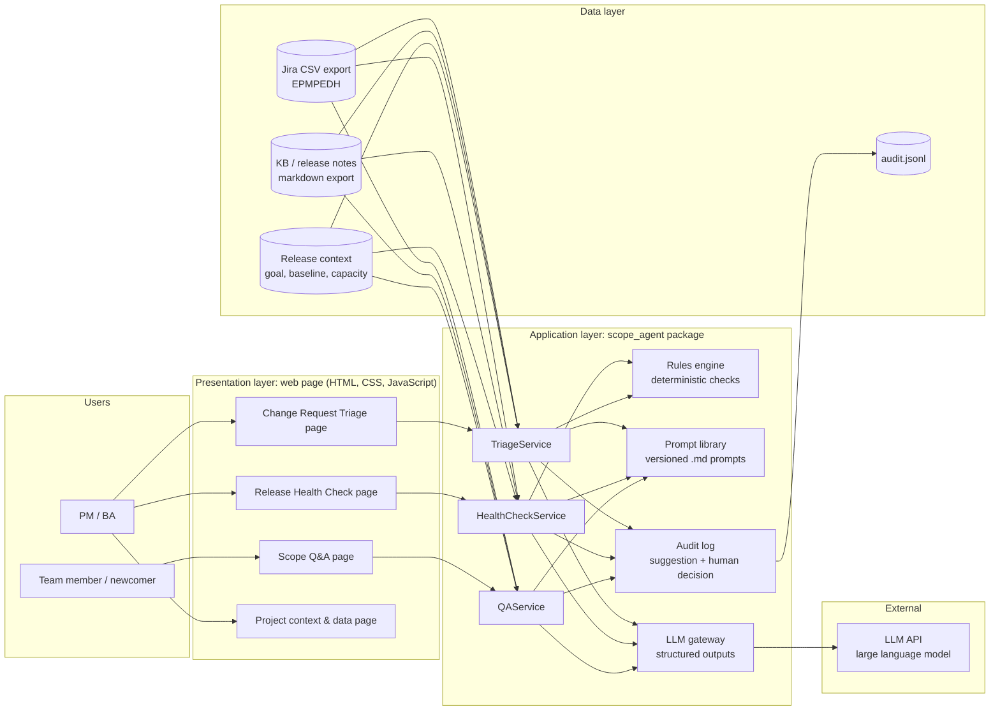
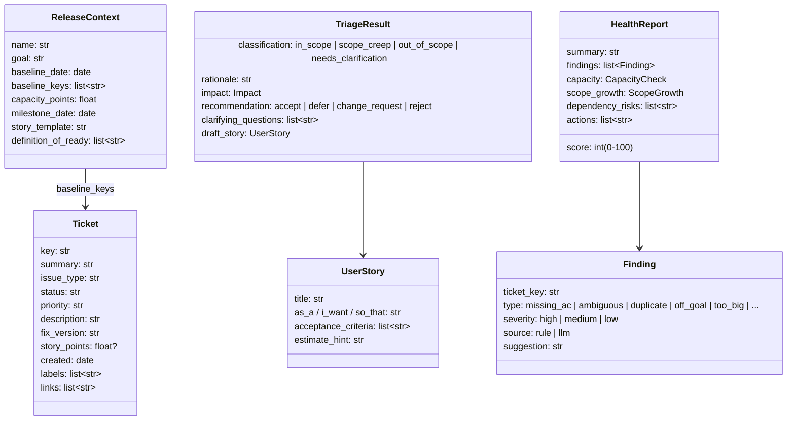
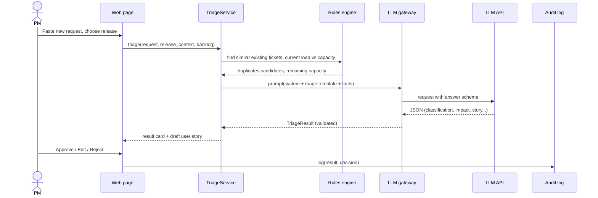
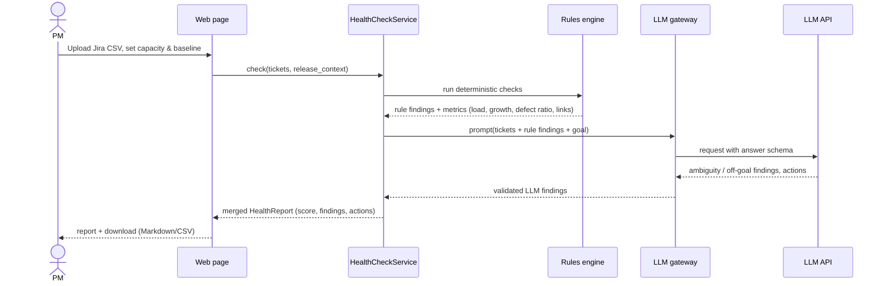

# Dog Hotel Scope Control Agent: Problem, Solution and Architecture

| | |
|---|---|
| **Student** | Isomiddin Pulatov |
| **Program** | ITPU MS Degree, IT Project Management & AI (2025–2026) |
| **Internship** | EPAM Systems, Inc. (Sep 1 – Oct 23, 2026) |
| **Project** | Dog Hotel (EPM-PEDH), EPAM volunteer project |
| **Focus area** | Project **scope** management (assigned by the scientific advisor on Sep 2) |
| **Thesis topic** | *Enabling Intelligent Scope Control: Designing an AI Agent for IT Project Management* |
| **Technical mentor** | Tymofii Nazar (PM) |
| **Scientific advisor** | Olha Kudoiarova |
| **Document status** | v0.1, Oct 16, 2026. Problem hypotheses are still being validated with the Dog Hotel team (see 2.5) |

---

## 1. Context

Dog Hotel is a real, active EPAM volunteer project, running since 2018. Its customers are a family who run a dog shelter and dog hotel in their private house. The team builds and maintains their website (production: https://www.doghotel.com.ua/), which has two parts:

- **User side**: public pages, information about the hotel and shelter, and booking/contact flows.
- **Admin side**: back office for the owners, available only on the test environment through EPAM VPN.

Project characteristics that shape the problem:

- **Volunteer team with high rotation.** Contributors (students, interns, EPAM volunteers) join and leave regularly, so onboarding material is large: about 3 hours of video plus a knowledge base (KB).
- **Real customers, no commercial contract.** The team itself says it delivers "slowly, with bugs, as capacity allows".
- **Standard tooling.** Jira project EPMPEDH (backlog, releases), KB/Confluence space EPMGPE (requirements, team structure, release notes), and Figma (designs).
- **Limited capacity.** People work part-time and capacity changes every sprint.

The internship task: study the current state of the project, assess it, find gaps in the chosen PM knowledge area (**scope**), and solve one real problem with an AI agent. The agent is demonstrated on **Oct 20, 2026**.

---

## 2. The problem

### 2.1 Scope management in theory

PMBOK splits scope management into six processes: *Plan Scope Management → Collect Requirements → Define Scope → Create WBS → Validate Scope → Control Scope*. The last one, **Control Scope**, monitors the scope status and manages changes to the **scope baseline**. When it is weak, the project suffers from:

- **Scope creep**: uncontrolled growth of scope without matching time and resources.
- **Gold plating**: work nobody asked for.
- **Unclear requirements**: rework and defects.

All three hurt schedule and quality.

### 2.2 How it shows up on Dog Hotel (observed symptoms and hypotheses)

| # | Symptom | Why it happens on this project | Consequence |
|---|---|---|---|
| P1 | **New requests enter the backlog without impact analysis.** Ideas from the owners, team members or the BA land in Jira directly | No formal change-control step; a volunteer PM/BA has little time for every request | Scope creep, release dates slip, the release goal blurs |
| P2 | **Uneven requirement quality.** Stories without acceptance criteria, vague descriptions, duplicates | Many authors with different experience; rotation; no automated Definition-of-Ready check | Rework, defects ("delivered with bugs"), long QA cycles |
| P3 | **Release scope isn't checked against capacity and dependencies** | Capacity is volatile (volunteers); dependencies between front-end, back-end and design are tracked informally | Overloaded releases, carry-over to the next release, milestone risk |
| P4 | **Scope knowledge is scattered and hard to reach.** "Is feature X in release Y?" needs KB pages, Jira and videos | High rotation; knowledge lives in a few people's heads | Newcomers depend on the PM/BA, who become a bottleneck |
| P5 | **Scope control is manual and person-dependent** | No tooling beyond plain Jira | It doesn't scale and gets skipped under time pressure |

### 2.3 Problem statement

> On the Dog Hotel project, scope is controlled manually by a small number of part-time people. Incoming change requests, the quality of backlog items, and the fit of a release's scope to the team's real capacity are not checked systematically. The result is scope creep, rework and slipping releases.

### 2.4 Why an AI agent is appropriate

- The work is **language-heavy**: reading requests, stories and KB pages, and writing user stories and acceptance criteria. Large language models are strong here.
- The decision needs **judgement plus rules**: "Is this within the release goal?" is judgement; "Does this story have acceptance criteria?" is a rule. A hybrid agent can do both.
- The cost of an error is **low and recoverable**: the agent only *recommends*, and a human approves every change (human-in-the-loop).

### 2.5 Validation status (honesty note)

P1–P5 are built from the project's own description (Sep 2 intro by the project PM), the mentor's analysis questions, and typical patterns of volunteer projects. Before the demo, they are being confirmed against:

1. A Jira export of the current release and backlog (EPMPEDH): % of stories without acceptance criteria, scope added after the release started, open vs closed defects, issue links.
2. Short questions to the Dog Hotel BA/PM: how release scope is planned, how new requests are handled, and the main complaints from retrospectives.

The findings (confirmed, partly confirmed or rejected) go into the internship report, section 4 "Conclusions and lessons learned".

---

## 3. The solution

### 3.1 Overview

**Dog Hotel Scope Control Agent** is an AI assistant for the project manager and business analyst. It automates the *Control Scope* and *Validate Requirements* routine, while every decision stays with a human.

```
New request / backlog / release plan  →  Agent analyses (rules + LLM)  →  Recommendation + draft artifacts  →  PM/BA approves or edits  →  Decision logged
```

### 3.2 Capabilities (MVP modules)

| Module | Solves | Input | Output |
|---|---|---|---|
| **M1. Change Request Triage** | P1, P2 | Free-text request (from the owners, team or BA) + release context (goal, baseline, capacity) | Classification (*in scope / scope creep / out of scope / needs clarification*), impact (effort, affected features, risks), recommendation (*accept to current release / defer to backlog / raise a formal change request / reject*), questions to clarify, and a **Jira-ready user story with acceptance criteria** in the project's format |
| **M2. Release Scope Health Check** | P2, P3 | Jira CSV export of a release/backlog + capacity | **Scope Health Report**: overall score; per-ticket findings (missing AC, ambiguity, duplicates, not linked to the release goal, too big to estimate); scope growth since baseline; load vs capacity; dependency risks; a prioritised list of actions (MoSCoW: what to cut first) |
| **M3. Scope Q&A** | P4 | A question in natural language | A grounded answer citing its sources (Jira keys, KB pages), with an explicit "not found / ask the BA" instead of guessing |

### 3.3 Human-in-the-loop: what stays with people

- The agent **never writes to Jira by itself**. It produces drafts and recommendations; the PM/BA accepts, edits or rejects them.
- The **release goal, scope baseline and capacity** are set by the PM.
- **Accepting a change into the release** is the PM's (and the customer's) decision.
- Every recommendation and the human decision on it are **logged**. This gives traceability and the data to evaluate the agent.

### 3.4 Expected value and success metrics

| Metric | How it's measured | Target for the MVP evaluation |
|---|---|---|
| Time to triage one change request | Manual (stopwatch) vs with the agent, on the same requests | ≥ 50% faster |
| Detection of stories without acceptance criteria / with ambiguity | Agent findings vs a manual review of the same 20–30 tickets | Recall ≥ 80% |
| Triage agreement with the PM | % of agent classifications the PM agrees with | ≥ 70% |
| Usefulness of generated stories | PM rating 1–5 | Average ≥ 4 |
| Q&A groundedness | % of answers whose cited sources actually support them | ≥ 90%, with no invented ticket keys |

These metrics come out of the evaluation harness (4.2, component 9). They feed the comparative "traditional vs AI-driven" analysis of the thesis.

### 3.5 Mapping to the mentor's analysis questions

| Mentor question | Where the agent helps |
|---|---|
| 1. Next milestone | M2 checks whether the release scope is achievable by the milestone date |
| 2. AI tools for speed/quality (scope focus) | The agent itself; comparison with CodeMie, EPAM AI DIAL and GitHub Copilot in the report |
| 3. Agent ideas for an SDLC step | Requirements and change control, the M1 + M2 steps |
| 4. How release scope is planned | M2 makes planning explicit: goal → candidate scope → capacity check → cut list |
| 5. Load on resources | M2 load vs capacity (aggregate; detailed resource optimisation is Asem's area) |
| 6. Open vs closed defects | M2 reports the defect ratio from the Jira export |
| 7. Tech debt vs features vs defects | M2 shows the scope mix per issue type and flags imbalance |
| 8. Dependencies that put the milestone at risk | M2 analyses issue links and blocked chains |

### 3.6 Out of scope for the MVP

- Automatic writes to Jira (planned as a "confirm & push" button later)
- Live Jira/Confluence API integration (the MVP uses CSV/markdown exports because of access constraints)
- Detailed resource levelling (covered by a teammate's agent)
- Multi-user deployment and authentication

---

## 4. Architecture

### 4.1 High-level view



The design principle is **"rules first, LLM for judgement"**:

- Everything that can be checked deterministically is computed in code: missing fields, counts, capacity math, dates, issue links. This part is fast, free, explainable and never hallucinates.
- The LLM handles what needs understanding of language and context: is a request inside the release goal, is a story ambiguous, write a good user story, answer a question from the docs.
- The LLM gets the rule results as facts, so its reasoning is anchored to real data.

### 4.2 Components

| # | Component | Responsibility | Implementation |
|---|---|---|---|
| 1 | **Web page + web server** (`web/`, `server.py`) | Five pages (overview and project data, request check, release health, questions, history); results shown as cards; Accept / Edit / Reject buttons; report download | HTML, CSS and JavaScript; a small FastAPI (Python) server |
| 2 | **Data ingestion** (`ingest/`) | `jira_csv.py` maps a Jira CSV export (Key, Summary, Issue Type, Status, Priority, Description, Fix Version, Story Points, Created, Labels, Issue Links…) to `Ticket` objects and tolerates different column names. `docs_loader.py` loads KB/release-notes text files and splits them into sections | pandas, Pydantic |
| 3 | **Release context** (`context.yaml` / UI form) | Release name and goal, baseline date, list of baseline ticket keys, capacity (person-hours or story points), milestone date, project conventions (story template, Definition of Ready) | Pydantic model |
| 4 | **Rules engine** (`rules.py`) | Deterministic checks: missing or weak acceptance criteria; empty or very short description; missing estimate; possible duplicates (text similarity); scope added after the baseline date; story-point total vs capacity; open/closed defect ratio; issue-type mix (feature / bug / tech debt); blocked or dependency chains from issue links | Pure Python (difflib similarity) |
| 5 | **Prompt library** (`prompts/`) | Versioned prompts: `system.md` (agent role, scope-control principles, human-in-the-loop rules, "never invent ticket keys"), `triage.md`, `health_check.md`, `qa.md`, plus the project's story template | Markdown files loaded at runtime |
| 6 | **LLM gateway** (`llm.py`) | One place for all calls to the LLM: **structured outputs** (JSON schema → validated Pydantic objects), refusal and cut-off handling, error handling, token counting, masking of personal data before sending, no storage on the provider side. It is the only module that knows the LLM provider, so the provider can be swapped (for example for EPAM AI DIAL or CodeMie) without touching the rest | The LLM provider's official Python SDK; the model and its settings are fixed in `config.py` |
| 7 | **Services** (`services/`) | `TriageService`, `HealthCheckService` and `QAService` orchestrate: load context → run rules → build prompt → call the LLM gateway → merge rule and LLM results → return a typed result | Python |
| 8 | **Audit log** (`audit.py`) | Appends every recommendation, the human decision (accepted/edited/rejected) and the timestamp to `audit.jsonl` | JSON Lines |
| 9 | **Evaluation harness** (`eval/`) | Runs the agent over labelled cases (requests and tickets with expected outcomes) and computes the metrics in 3.4. Also records manual-vs-agent timings | Python script → CSV/Markdown results for the report |

### 4.3 Data model (core types)



### 4.4 Key flows

**M1: Change Request Triage**



**M2: Release Scope Health Check**



**M3 (Scope Q&A)** follows the same pattern. The relevant KB sections and tickets go into the prompt (the corpus is small enough for the model's context window, with prompt caching for repeated questions). The model must cite source keys and answer "not found" when the sources don't cover the question.

### 4.5 Project structure

```
DogHotelIsomiddin/
├── docs/
│   └── Scope_Control_Agent_Problem_Solution_Architecture.md   ← this document
├── notes/                         findings from Teams, plan, answers to mentor questions
├── agent/
│   ├── server.py                  web server (FastAPI)
│   ├── web/                       the web page: index.html, styles.css, app.js
│   ├── run.bat                    starts the app and opens the browser
│   ├── requirements.txt
│   ├── .env                       the LLM API key (never committed)
│   ├── README.md                  how to install, run and demo
│   ├── scope_agent/
│   │   ├── config.py              settings (LLM, paths)
│   │   ├── models.py              Pydantic data model (4.3)
│   │   ├── llm.py                 LLM gateway
│   │   ├── rules.py               rules engine
│   │   ├── audit.py               audit log
│   │   ├── ingest/
│   │   │   ├── jira_csv.py
│   │   │   └── docs_loader.py
│   │   ├── services/
│   │   │   ├── triage.py
│   │   │   ├── health.py
│   │   │   └── qa.py
│   │   └── prompts/
│   │       ├── system.md
│   │       ├── triage.md
│   │       ├── health_check.md
│   │       └── qa.md
│   ├── data/
│   │   ├── sample/                clearly labelled SAMPLE data for development
│   │   └── real/                  real Dog Hotel exports (kept local)
│   ├── eval/
│   │   ├── cases/                 labelled evaluation cases
│   │   └── run_eval.py            metrics for the report
│   └── tests/                     unit tests for rules and ingestion
├── demo/                          demo script, slides, backup video
├── report/                        internship report (.docx)
└── feedback/                      pre-filled supervisor feedback form
```

### 4.6 Technology stack

| Layer | Choice | Why |
|---|---|---|
| Language | Python 3.13 | Fast to build, strong data libraries |
| UI | Own web page (HTML, CSS, JavaScript) served by FastAPI | Clean, professional layout with large readable text; no heavy framework in the browser |
| LLM | A large language model (LLM) through its provider's API, with fixed settings | Strong reasoning and writing; a large context (a whole release fits); structured outputs give validated JSON |
| Validation | Pydantic | Typed data model; validates both inputs and LLM outputs |
| Data | pandas + CSV/markdown exports | Works with read-only exports while API access is limited |
| Storage | Local files (JSONL audit log, CSV/MD reports) | No database needed for the MVP |
| Alternative platform | EPAM CodeMie assistant | The same system prompt can run as a CodeMie assistant with Jira/Confluence integration (mentor's recommended path for team adoption) |

### 4.7 Security and data privacy

- **Secrets:** the API key lives in a local `.env` file and is never written in code, documents or the repository.
- **Personal data:** Dog Hotel deals with real customers (pet owners). Before any text goes to the LLM, the gateway masks e-mails, phone numbers and similar personal data. Only backlog/requirement text is sent; no production data.
- **Least privilege:** the agent only *reads* exports. There are no write credentials to Jira in the MVP.
- **Human approval:** the agent cannot change the project by itself; every change goes through a person.
- **Traceability:** every recommendation and decision is logged with a timestamp.

### 4.8 Deployment options

1. **Local demo (MVP, Oct 20):** double-click `agent/run.bat` on the student's laptop; the page opens at http://localhost:8765. Exports go into `data/real/`.
2. **CodeMie assistant (team adoption):** the system prompt and templates are published as an assistant on codemie.lab.epam.com, connected to the project's Jira and Confluence. Team members use it without installing anything.
3. **Future:** a Jira-integrated bot that comments its triage on new tickets and pushes approved stories (with a human click).

### 4.9 Limitations and risks

| Risk / limitation | Mitigation |
|---|---|
| LLM output may be wrong or overconfident | Rules anchor the facts; validated schema; human approval; evaluation on labelled cases |
| Limited access to real Jira/KB (device and VPN requirements) | CSV/markdown exports; teammate or PM shares an export; sample data clearly labelled until then |
| Small evaluation set (2-month internship) | Present results as a pilot study; describe the threats to validity in the report |
| Cost and latency of a large model | Rules do the cheap work; prompt caching for repeated context; a fixed, low reasoning setting (about 10 seconds per request and under 30 seconds for a full release check, with the same evaluation results as a higher setting) |
| Adoption by a volunteer team | Zero-install option through CodeMie; outputs in the team's own story format |

### 4.10 Roadmap

| When | Milestone |
|---|---|
| Oct 17–18 | MVP: M1 + M2 + M3 working on real or sample data; evaluation run |
| Oct 19 | Dry run; feedback from the scientific advisor |
| **Oct 20** | **Final demo** to the mentor and the internship panel |
| Oct 21–25 | Internship report with evaluation results; feedback form |
| After the internship (thesis) | Larger evaluation; Jira API integration; comparison of traditional vs AI-driven scope control; CodeMie deployment for the team |
